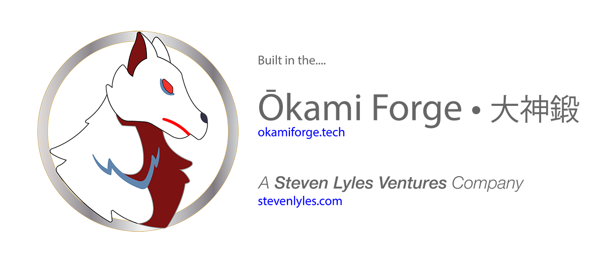

## Ōkami Forge • 大神鍛
<b>Fire (Ka)</b> • Power, Passion and Motivation

Named after the Japanese great wolf spirit (大神) - ancient, divine protectors sent by the mountain gods to safeguard travelers and everyday people on their journey. Bold, powerful, and intensely loyal, the wolf embodies noble strength in service of others. The Forge represents the alchemical transformation of raw inspiration into real, powerful, useful things. Together they capture the driving of inner vision into outer reality through determined, intelligent, engineering. _The bold forge of dreams into reality._

**Ōkami Forge** is the technical, left-brained company - the fire element. Here we forge both software and hardware products to empower clients on their journeys into the future.
